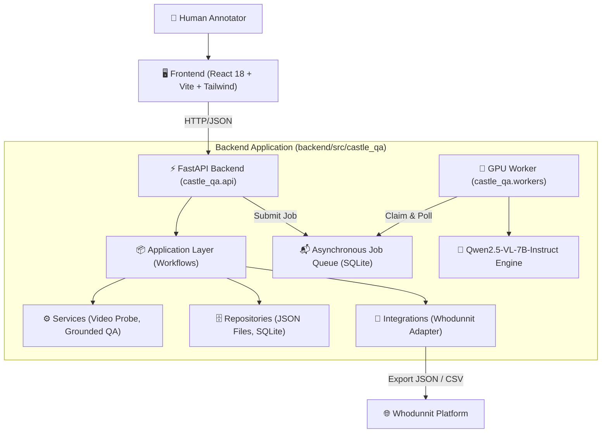
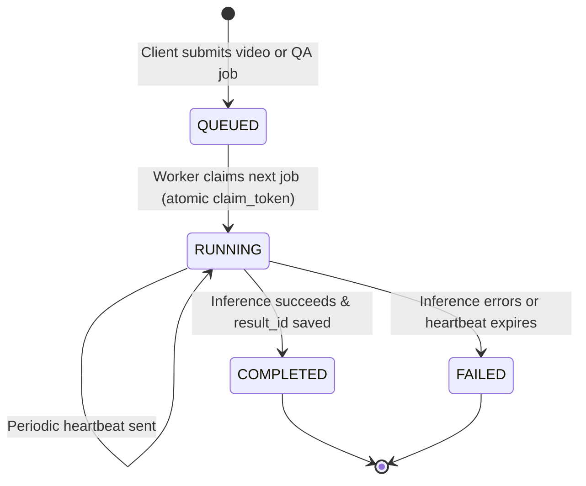

# CASTLE QA Studio — Architecture Documentation

## Overview

CASTLE QA Studio is an AI-assisted video understanding and grounded question-answering system designed to accelerate human annotation workflows for the Whodunnit platform.

The system processes short video clips, extracts chronological event timelines with millisecond-accurate timestamps, answers user queries grounded in observable video evidence, manages annotation review sessions, and exports validated annotations into Whodunnit-compatible formats.

---

## High-Level Architecture



---

## Directory Organization

```text
castle-question-generation/
├── backend/                              # Python backend application & package
│   ├── src/castle_qa/                    # Installable 'castle_qa' package
│   │   ├── api/                          # FastAPI app, routers, schemas, dependencies
│   │   ├── domain/                       # Pure dataclasses & business entities
│   │   ├── application/                  # Use-case workflows (Video, QA, Analysis)
│   │   ├── infrastructure/               # Database (SQLAlchemy) & Repositories
│   │   ├── integrations/                 # Whodunnit export adapter
│   │   ├── services/                     # Business logic (video probe, Qwen engines)
│   │   ├── workers/                      # Continuous polling worker & recovery
│   │   ├── config/                       # Typed application settings
│   │   └── utils/                        # Timestamp helpers
│   ├── tests/                            # Pytest unit, e2e, and integration tests
│   ├── alembic/                          # Database migration scripts
│   ├── prompts/                          # Prompt templates
│   ├── alembic.ini                       # Alembic configuration
│   └── pyproject.toml                    # PEP 621 package & dependency definition
│
├── frontend/                             # React + Vite + TypeScript application
│   ├── src/
│   │   ├── app/                          # App setup and routing
│   │   ├── features/                     # Feature-driven slices
│   │   │   ├── videos/                   # Video playback & upload modals
│   │   │   ├── video-understanding/      # Timeline & event visualization
│   │   │   ├── question-answering/       # Grounded QA panel & chips
│   │   │   └── annotations/              # Review workspace & Whodunnit export
│   │   └── shared/                       # Shared API client, types, components
│   └── package.json
│
├── docker/                               # Production container definitions
│   ├── api.Dockerfile                    # CPU-optimized FastAPI container
│   ├── worker.Dockerfile                 # CUDA/GPU worker container
│   ├── frontend.Dockerfile               # Multi-stage Nginx container
│   └── nginx.conf                        # Reverse proxy & static routing
│
├── scripts/                              # Utility and operational scripts
├── docs/                                 # Architecture & deployment docs
├── data/                                 # Runtime data storage (gitignored)
├── compose.yaml                          # Multi-service local & production stack
└── README.md                             # Project overview & developer guide
```

---

## Backend Architectural Layers

1. **Domain (`castle_qa.domain`)**
   - Pure domain models (`Event`, `VideoAnalysis`, `InferenceJob`, `AnnotationReviewSession`, `GroundedQA`).
   - Zero external framework dependencies.

2. **Infrastructure (`castle_qa.infrastructure`)**
   - Database persistence using SQLAlchemy ORM (`InferenceJobORM`).
   - Repository implementations (`JobRepository`, `VideoAnalysisRepository`, `QuestionRepository`, `AnnotationRepository`).
   - Crash recovery, heartbeat tracking, and optimistic concurrency locks.

3. **Application (`castle_qa.application`)**
   - High-level orchestrators: `VideoUnderstandingWorkflow`, `QuestionWorkflow`, `AnalysisWorkflow`.
   - Coordinates domain models, inference models, and persistence.

4. **Services & Integrations (`castle_qa.services`, `castle_qa.integrations`)**
   - Video probing via FFprobe (`VideoProbe`).
   - Qwen2.5-VL vision-language inference and prompt management.
   - Evidence grounding algorithm matching questions to observed video intervals.
   - `WhodunnitExportAdapter` adapting human-verified events and questions to Whodunnit schema.

5. **API (`castle_qa.api`)**
   - FastAPI routers under `/api/v1/`: `videos`, `jobs`, `analyses`, `questions`, `qa`, `annotations`, `health`.
   - Centralized dependency injection in `castle_qa.api.dependencies`.
   - Pydantic v2 schemas for request validation and response serialization.

6. **Workers (`castle_qa.workers`)**
   - Standalone CLI entry points (`castle_qa.workers.entrypoint`).
   - Continuous polling runner with exponential backoff and graceful SIGINT/SIGTERM shutdown.
   - Heartbeat thread maintaining job lease and automatic stale job recovery.

---

## Data & Job Lifecycle



