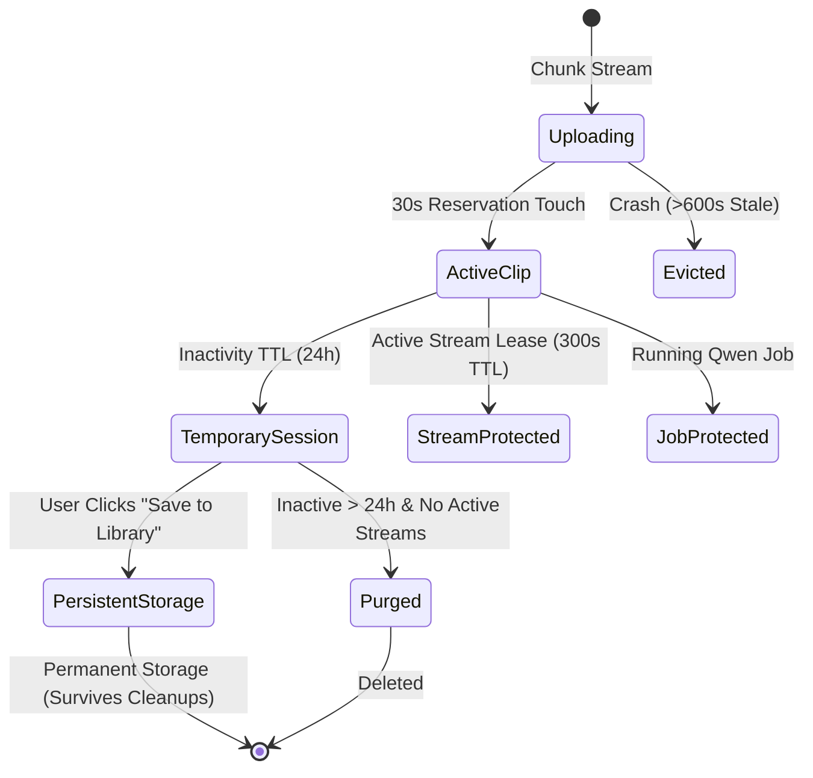

# CASTLE QA Studio — Architecture & Technical Design

## 1. System Overview

CASTLE QA Studio is an annotation assistance platform designed to extract, inspect, and evaluate event timelines and question-answering pairs from long video recordings (such as the CASTLE dataset).

### Core Design Principles
1. **Local-First Privacy**: Original recordings remain local. One continuous user-selected clip (up to 600 seconds and 1 GB) is uploaded to the backend server for analysis.
2. **Dual-Mode Inference Execution**: The system supports two execution paths:
   - `VIDEO_UNDERSTANDING_MODE=mock`: CPU-only deterministic simulation for local laptop development and fast CI testing.
   - `VIDEO_UNDERSTANDING_MODE=real`: Genuine GPU-accelerated inference using `Qwen/Qwen2.5-VL-7B-Instruct` on dedicated NVIDIA hardware.
3. **Dual Timestamp Provenance**: Every extracted event preserves two timestamp representations:
   - **Clip-relative timestamps** (`0.0` to `duration_seconds`) for playback synchronization in the local media player.
   - **Source-video timestamps** (e.g., `120.0s` to `145.0s`) for correspondence with the original 1-hour CASTLE recording and dataset ground truth.
4. **Temporary Media Lifecycle**: Extracted clips and exploratory analyses are temporary by default (24-hour inactivity TTL), protected by active inference jobs and active stream leases, and survive only when an annotator explicitly triggers "Save to Library".

---

## 2. Architecture Diagram

```mermaid
flowchart TD
    subgraph Browser Client
        UI["ReactJS + Vite UI"]
        Player["HTML5 VideoPlayer (Interval Scrubber)"]
        ClipExt["Local Clip Extractor (Mode A/B/C)"]
        Timeline["Chronological Event Timeline"]
        QAPanel["Grounded QA Panel"]
        ReviewSpace["Whodunnit Review Workspace"]
    end

    subgraph FastAPI Backend
        Router["FastAPI Application (Port 8000)"]
        SizeMW["RequestSizeLimitMiddleware (Chunk-level)"]
        VidSvc["VideoService (Temporary Storage & Ingestion)"]
        Tracker["StreamLeaseTracker (Cross-Process File Leases)"]
        SessSvc["TemporarySessionService (24h Inactivity Tracking)"]
        JobRepo["JobRepository (SQLite Queue)"]
        QASvc["GroundedVideoQAService (Lexical Evidence Grounding)"]
        ExportAdapter["WhodunnitExportAdapter (CSV / JSON)"]
    end

    subgraph Worker Process
        WorkerRunner["WorkerRunner (Heartbeat Thread + Atomic Claims)"]
        EngineFactory["VideoUnderstandingFactory"]
        MockEngine["MockVideoUnderstandingService"]
        RealEngine["LocalQwenVideoUnderstandingService (Qwen2.5-VL)"]
    end

    subgraph Persistent & Temporary Storage
        RawVideos["data/videos (Original Recordings - Read-Only)"]
        TempClips["data/clips/temp_uploads (Temporary Clips)"]
        Leases["data/clips/temp_uploads/leases (*.lease)"]
        Reservations["data/clips/temp_uploads/.reservations (*.reserve)"]
        AnalysisStore["data/analysis (Structured Event JSON)"]
        ReviewStore["data/reviews (Annotation Sessions)"]
        JobDB["data/jobs/jobs.sqlite3 (Job Queue Database)"]
    end

    %% Interactions
    Player --> ClipExt
    ClipExt -- "One clip upload (max 1GB)" --> SizeMW --> VidSvc
    VidSvc --> TempClips
    VidSvc --> Reservations
    Router --> Tracker --> Leases
    Router --> SessSvc
    Router --> JobRepo --> JobDB
    Router --> QASvc
    Router --> ExportAdapter

    WorkerRunner --> JobDB
    WorkerRunner --> EngineFactory
    EngineFactory --> MockEngine
    EngineFactory --> RealEngine
    MockEngine --> AnalysisStore
    RealEngine --> AnalysisStore
```



---

## 3. Component Details

### 3.1 React Frontend
- **Framework**: React 18, TypeScript, Vite, Tailwind CSS.
- **Local Video Management**: [useLocalVideo.ts](file:///d:/DCU-Internship/castle-question-generation/frontend/src/features/videos/useLocalVideo.ts) manages browser `File` references, creates isolated `blob:` Object URLs, and revokes unused URLs on replacement or teardown to prevent memory leaks.
- **Local Extraction Modal**:
  - **Mode A (Native FFmpeg Command)**: Generates verified `-ss <start> -i <file> -to <end> -c copy` commands (without forced overwrite `-y`) for fast local terminal execution.
  - **Mode B (Short Clip Import)**: Allows dragging and dropping the locally extracted clip file into the workspace.
  - **Mode C (Experimental Browser Capture)**: Uses `HTMLVideoElement.captureStream()` and `MediaRecorder` directly in the browser to extract short WebM/MP4 clips without external utilities.
- **Timeline & Seeking**: Clicking an event or QA evidence badge immediately seeks the `VideoPlayer` to that exact second, highlighting the supporting timestamp interval.

### 3.2 FastAPI Backend
- **Framework**: FastAPI `>=0.115`, Starlette, Pydantic V2.
- **Streaming & Range Requests**: Uses `FileResponse` to support HTTP byte-range requests for seamless video scrubbing.
- **Request Size Enforcement**: `RequestSizeLimitMiddleware` inspects chunked stream length as bytes arrive, aborting with `413 Request Entity Too Large` before memory or disk spooling exceeds configured limits.
- **Session-Secured Stream Lease Renewal**: Temporary video streaming endpoints authenticate session ownership before extending leases.

### 3.3 Asynchronous Job Queue
- **Engine**: SQLite with WAL mode (`journal_mode=WAL`) and `busy_timeout=5000`.
- **Atomic State Transitions**: Transitions (`queued` -> `running` -> `completed` / `failed`) use single atomic UPDATE statements with unique claim tokens.
- **Worker Crash Recovery**: Background heartbeat threads update `last_heartbeat_at` every 2 seconds. If a worker process crashes, orphan jobs are safely marked `failed` or re-queued after the heartbeat expiration threshold.

### 3.4 Grounded Video Question Answering
- **Current Baseline**: [GroundedVideoQAService](file:///d:/DCU-Internship/castle-question-generation/backend/src/castle_qa/services/video_qa_service.py) performs lexical and semantic token matching across the extracted event timeline.
- **Evidence Intervals**: Returns start/end timestamps of the events containing the highest evidence match score.
- **Observability Determination**: Distinguishes directly observed actions (e.g., "Person1 opens microwave") from unobservable actions ("Person1 likes coffee").
- **Confidence Badge**: Displays an amber heuristic match score. It is clearly labeled as an evidence-matching score, not a calibrated neural probability.

### 3.5 Whodunnit Annotation Review and Export
- **Review Workspace**: Annotators review each candidate event and question, toggle acceptance status (`accepted`, `rejected`, `edited`), and adjust descriptions.
- **Distractor Generation**: For multi-choice questions, distractors are generated using other actor names and plausible actions extracted from the video context.
- **Export Formats**:
  - **JSON**: Hierarchical annotation package with video metadata, event intervals, question-answer pairs, and review provenance.
  - **CSV**: Flat tabular structure suitable for spreadsheet review and bulk ingestion.
  - *(Note: Exports use a compatible draft adapter, not an official certified schema)*.

---

## 4. Dual Timestamp Architecture

To preserve the selected interval's source location, timestamps are tracked in dual coordinate spaces:

```
Source Video (1 hour, 3600s):
|--------------------------[   Selected Interval   ]----------------------------|
0s                        120s                    145s                        3600s
                           |                       |
                           v                       v
Uploaded Clip (25s):      0s                      25s
                           |                       |
Event Inside Clip:        |-------[ Action ]-------|
Clip Timestamps:          10s                     15s
Source Timestamps:        130s                    135s (offset + 120s)
```

1. **Clip Relative**: Stored in analysis events as `start_seconds` and `end_seconds`. Used directly by `<video>` player in the browser. Real Qwen inference samples uniformly across the full clip at up to 64 frames to fit the model input budget; the clip itself is not split or shortened.
2. **Source Relative**: Stored as `source_start_seconds` and `source_end_seconds`. Calculated via `source_start_seconds = clip_start_seconds + offset`. Used when exporting annotations for benchmark training.

---

## 5. Storage Lifecycle and Concurrency Safety



- **Active Uploads**: Protected by `.reserve` files in `.reservations/`. Streaming touches the file every 30 seconds. Crashed uploads (> 600s without touch) are safely evicted by subsequent upload requests.
- **Active Playback**: Protected by `.lease` files in `leases/`. Renewed via `POST /stream-lease/{video_id}/{lease_id}/renew`.
- **Inactivity Expiration**: Default 24 hours of meaningful inactivity (`session.last_active_at`). Touched by user interaction or `POST /session/{session_id}/touch`.
- **Permanent Datasets**: Files in `data/videos` (including the golden CASTLE video `kitchen_8_day_1.mp4`) are strictly excluded from cleanup runners and mounted read-only (`:ro`) in container environments.
