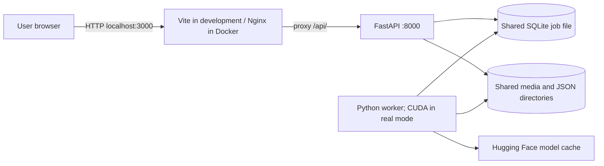
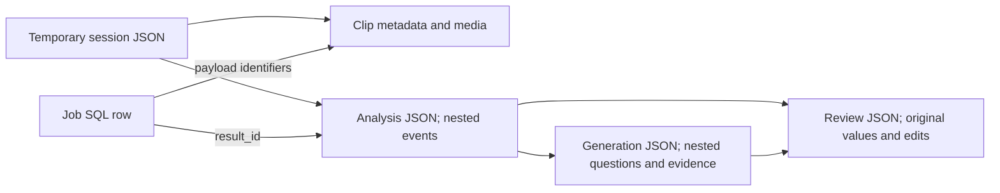

# Learn CASTLE QA Studio from Python and OOP

This guide explains the checked-out implementation as inspected on 28 October 2026. It assumes you know Python classes, functions, lists, dictionaries, and exceptions. You do not need prior React, TypeScript, SQL, web framework, or LLM experience.

The product takes a selected video clip, produces an event timeline, and generates draft questions grounded in those events. Most code around that idea handles ordinary software concerns: files, user interaction, validation, persistence, background work, and errors.

Read these chapters in order:

1. This page: the mental model, technologies, folders, architecture, database, workers, LLMs, and testing.
2. [Routes and function contracts](ROUTES_AND_CONTRACTS.md): inputs, outputs, examples, errors, and side effects.
3. [Code walkthrough](CODE_WALKTHROUGH.md): Python-to-TypeScript bridge, your five open tabs, and backend/test execution.
4. [Source atlas](SOURCE_ATLAS.md): generated Python signatures and route inventory for looking up implementation details.

The walkthrough teaches executable statements and related groups of declarations. It does **not** claim to individually explain every line of every source file. A whole-repository literal line commentary would repeat thousands of styling, schema, and test lines and become stale quickly. Instead, all five open tabs have a reading map, foundational files have detailed statement explanations, and every backend function has a lookup entry in the atlas.

## Start with the running system

Think of a restaurant: the browser takes the user's request, the API records the order, the worker cooks it, and storage remembers the order and result. The browser asks periodically whether the result is ready.

```mermaid
sequenceDiagram
    participant User
    participant UI as React in browser
    participant API as FastAPI process
    participant DB as SQLite jobs
    participant W as Worker process
    participant Files as JSON and media files
    User->>UI: Open local recording and select interval
    UI->>UI: Prepare a short clip
    UI->>API: POST multipart clip upload
    API->>Files: Store clip and source metadata
    API-->>UI: video_id and session credentials
    UI->>API: POST video-understanding job
    API->>DB: INSERT queued job
    API-->>UI: 202 and job_id
    W->>DB: Atomically claim queued job
    W->>Files: Read clip, infer, save analysis JSON
    W->>DB: Mark completed with result_id
    UI->>API: GET job status, repeatedly
    API-->>UI: completed and result_id
    UI->>API: GET analysis by result_id
    API-->>UI: Summary and events
    User->>UI: Generate questions
    UI->>API: POST question-generation job with analysis_id
    Note over W,Files: Generate from saved events; save question JSON
```

Opening a local recording creates a browser `blob:` URL. That is a browser reference to a file, not an HTTP upload and not a server filesystem path. Uploading happens later, explicitly, for the prepared clip.

Three different IDs matter: `video_id` locates media, `job_id` locates work, and `analysis_id` locates structured results. A completed job's `result_id` points to an analysis or generation. Do not assume a made-up ID naming convention; use the returned identifier.

## Install and run

Run commands below from the repository root. They are instructions, not commands executed as part of writing this guide.

For local development, create and activate a Python environment using your usual Python tooling, then:

```powershell
python -m pip install -e "./backend[api,dev]"
python -m alembic -c backend/alembic.ini upgrade head
npm --prefix frontend install
```

`-e` installs the local Python package in editable mode: imports resolve to your source checkout. `[api,dev]` requests optional dependency groups from `backend/pyproject.toml`. `npm --prefix frontend` tells npm where `package.json` lives.

FFmpeg and ffprobe must also be installed and available on PATH. Check with `ffmpeg -version` and `ffprobe -version`. These executables are separate from Python packages.

Run these in three terminals:

```powershell
# Terminal 1: HTTP API
python -m uvicorn castle_qa.api.main:app --host 127.0.0.1 --port 8000

# Terminal 2: inference queue consumer, no GPU needed
python -m castle_qa.workers.entrypoint --mock-models

# Terminal 3: browser development server
npm --prefix frontend run dev
```

Open `http://localhost:3000`. Explore `http://127.0.0.1:8000/docs` for interactive request forms and `http://127.0.0.1:8000/openapi.json` for machine-readable contracts. These URLs describe your own running API.

The CLI explicitly declares `--mock-models`. Existing instructions sometimes use `--mock`; argparse currently accepts that unambiguous abbreviation, but the full declared option is clearer.

The repository declares Python >=3.10. Node compatibility also depends on the installed frontend testing dependencies; some newer dev packages can require more than the README's historical Node 18 minimum. Respect npm engine warnings and the lockfile instead of assuming that minimum covers every tool.

Docker alternative:

```powershell
docker compose up -d --build
docker compose exec api python -m alembic -c /app/alembic.ini upgrade head
```

Compose defaults inference to mock, but the worker Dockerfile still builds an image with GPU dependencies. Therefore CPU execution does not imply a small CPU-only worker image. For an NVIDIA host, the GPU override is:

```powershell
docker compose -f compose.yaml -f compose.gpu.yaml up -d --build
docker compose -f compose.yaml -f compose.gpu.yaml exec api python -m alembic -c /app/alembic.ini upgrade head
```

See [GPU deployment](../LAB_GPU_DEPLOYMENT.md) for hardware setup. This guide does not claim the GPU environment has been validated on your computer.

## Technologies: what each does and where it appears

Versions below describe manifest declarations, not a report of installed versions. A constraint such as `^18.2.0` or `>=2.0,<2.1` is an allowed range. The resolved installation is a separate fact.

### Browser and frontend

Install this group together with `npm --prefix frontend install`.

| Technology | Why it is here | Where to read | How you use it |
| --- | --- | --- | --- |
| JavaScript | Browser execution language; event handlers, promises, objects | All frontend source after TS compilation | Learn variables, arrays, objects, functions, modules, events, `async/await` |
| TypeScript, declared ^5.2.2 | Checks object shapes and function contracts before running | `shared/types/index.ts`, `tsconfig.json` | `npm --prefix frontend run build` runs `tsc` first |
| React, declared ^18.2.0 | Updates UI from state and composes reusable components | `App.tsx`, feature `.tsx` files | Write components, pass props, call hooks at component top level |
| react-dom | Connects React to browser DOM | `main.tsx` | `createRoot(...).render(<App />)` mounts the app |
| Vite, declared ^5.1.6 | Development server, React tooling, production bundling, API proxy | `vite.config.ts` | `run dev`, `run build`, `run preview` |
| @vitejs/plugin-react | React integration for Vite | `vite.config.ts` | Registered in `plugins: [react()]` |
| Tailwind CSS 3 | Small utility classes compose styling without a CSS rule for every element | `Header.tsx`, `App.tsx`, `index.css`, `tailwind.config.js` | `className="flex ..."`; included in Vite CSS build |
| PostCSS and Autoprefixer | Process CSS and add compatibility prefixes | `postcss.config.js` | Run through the build; normally no separate command |
| lucide-react | Reusable SVG icon components | `Header.tsx`, `App.tsx`, feature panels | Import an icon and render `<Video />` |
| @types/react and @types/react-dom | Editor/compiler declarations for React APIs | Type checking throughout frontend | Installed as development dependencies |
| Browser File, Blob, URL | Local file selection and preview | `useLocalVideo.ts` | `URL.createObjectURL(file)`, then revoke when unused |
| HTML video, captureStream, MediaRecorder | Playback and optional browser clip capture | `VideoPlayer.tsx`, `browserCaptureExtractor.ts` | Media events and a recording lifecycle |
| fetch and XMLHttpRequest | HTTP calls to Python API | `shared/api/client.ts` | `fetch` for JSON; XHR upload progress for clip uploads |

The browser APIs in the last three rows are built in, not npm packages. There is no Redux store, React Router, Axios, or frontend SQL connection in the current package manifest. Component state drives the main workspace; feature folders do not automatically create URL routes.

Official starting points: [React Quick Start](https://react.dev/learn), [TypeScript introduction](https://www.typescriptlang.org/docs/handbook/typescript-in-5-minutes.html), [Vite guide](https://vite.dev/guide/). Their current documentation can target newer versions than this repository; learn concepts there and use this repo's manifests for compatibility.

### Python API and storage

Install using the editable backend command above. `backend/pyproject.toml` defines the package and optional groups; `requirements-api.txt` is also used during container builds.

| Technology | Why it is here | Where used | How you use it |
| --- | --- | --- | --- |
| FastAPI | Maps HTTP requests to Python functions; dependency injection; OpenAPI | `api/main.py`, `api/routers/` | Start with Uvicorn; add an `APIRouter` endpoint |
| Uvicorn | Runs the ASGI application and listens on a TCP port | CLI and `docker/api.Dockerfile` | `python -m uvicorn castle_qa.api.main:app ...` |
| Starlette | Underlying web primitives used by FastAPI | `FileResponse`, `BackgroundTask`, middleware | Streaming/file responses and lifecycle hooks |
| Pydantic 2 | Validates incoming data and shapes outgoing JSON | `api/schemas/` | Subclass `BaseModel`; define `Field` constraints |
| python-multipart | Parses browser form/file uploads | `UploadFile`, `File`, `Form` in video routes | Send `multipart/form-data`, not JSON, for binary files |
| SQLite | Durable job queue in a local database file | `data/jobs/jobs.sqlite3` by default | Inspect with SQL; API and worker must share the same file |
| SQLAlchemy 2 | Builds SQL, maps job rows to Python objects, manages transactions | `infrastructure/database/`, `repositories/job_repository.py` | Engine → session → select/update/commit |
| Alembic | Applies ordered database schema changes | `backend/alembic/`, `alembic.ini` | `python -m alembic -c backend/alembic.ini upgrade head` |
| pathlib, dataclasses, json, enum, threading, subprocess | Standard Python building blocks, no pip installation | Domain models, repositories, worker, FFmpeg bridge | These build on your existing Python knowledge |
| python-dotenv | Supports environment configuration in legacy/config paths | `config/settings.py` | Distinguish dotenv loading there from `APISettings`, which reads `os.environ` |

Read [FastAPI tutorial](https://fastapi.tiangolo.com/tutorial/), [SQLAlchemy 2.0 tutorial](https://docs.sqlalchemy.org/en/20/tutorial/), and [Alembic tutorial](https://alembic.sqlalchemy.org/en/latest/tutorial.html). Learn request/response first, then sessions/transactions, then migrations.

### Video and AI

| Technology | Purpose | Actual project location |
| --- | --- | --- |
| FFmpeg | Extract/re-encode video; native command mode can also copy encoded streams | `video_clip_extractor.py`, `nativeCommandGenerator.ts` |
| ffprobe | Read media duration, streams, dimensions, codec | `services/video_probe.py`, upload validation |
| PyTorch (`torch`) | Tensor computation and model execution on CUDA | `local_qwen_video_understanding_service.py` |
| Transformers | Processor/model loading and autoregressive text generation | Same file; `qwen_local_question_generator.py` |
| Qwen2.5-VL-7B-Instruct | Pretrained vision-language model; clip → structured description; text evidence → questions | Worker handler factory; default model name in Compose |
| Accelerate | Supports model placement used through `device_map="auto"` | GPU dependency group and Transformers loading |
| safetensors | Model-weight serialization support used by model loading | GPU dependency set; no dedicated business service |
| av, torchcodec | Video decoding support in the GPU dependency stack | GPU requirements/processor backend; not independent API routes |
| Pillow and NumPy | Image/array support in multimedia/ML stack | Backend manifests; primarily supporting dependencies here |
| torchvision | Vision support for PyTorch ecosystem | GPU manifests; not a standalone application feature |
| qwen-vl-utils | Declared in optional/dev GPU sets | The current local service uses processor chat templates directly; do not assume every declared package has a direct import |
| Hugging Face cache | Reuses downloaded model files | `compose.gpu.yaml`: named `model_cache` volume |

There are multiple GPU dependency declarations: optional `[gpu]`, `requirements-dev.txt`, and the container's `requirements-gpu.txt`. They differ, notably in Transformers constraints. Read the deployment-specific files together; installing everything from every file is not a coherent environment strategy. The container path pins a CUDA/PyTorch stack; the ordinary local mock path avoids loading it.

For learning the exact model APIs, read the official [Qwen2.5-VL Transformers documentation](https://huggingface.co/docs/transformers/model_doc/qwen2_5_vl). The project's adapter code is the source of truth for its chosen invocation and version assumptions.

### Testing and deployment dependencies

| Tool | Why | Where | Command |
| --- | --- | --- | --- |
| pytest | Python test discovery, assertions, fixtures | `backend/tests/` | `python -m pytest backend/tests` |
| httpx / FastAPI TestClient | Exercise HTTP routes in tests without a separate listening API | API tests, `conftest.py` | Installed with backend `[dev]`; executed by pytest |
| Python unittest.mock | Replace expensive/unavailable collaborators; record calls | Worker/model tests | Standard library |
| Node built-in test runner | Small frontend-side checks without a component renderer | `frontend/tests/test_local_video.mjs` | `npm --prefix frontend run test:unit` |
| Vitest | TypeScript test runner, assertions and spies | `frontend/tests/*.test.tsx` | `npm --prefix frontend run test:components` |
| Testing Library React/DOM | Render components and interact through UI elements | Component tests | Runs within Vitest |
| jest-dom | Assertions such as `toBeDisabled`, `toBeInTheDocument` | `frontend/tests/setup.ts` | Extends test assertions; does not mean Jest is the runner |
| happy-dom | Simulated browser DOM for component tests | `vite.config.ts`: `environment: 'happy-dom'` | Used automatically by Vitest |
| jsdom | Another declared DOM package | `package.json` | Declared, but happy-dom is the configured global test environment |
| Playwright | Automates a real browser | `frontend/e2e/`, `playwright.config.ts` | `npm --prefix frontend run test:e2e` |
| Docker | Packages OS tools, Python/Node dependencies, source | `docker/*.Dockerfile` | `docker compose ...` |
| Compose | Starts API, worker, frontend with shared volumes and environment | `compose.yaml`, GPU override | `docker compose up -d --build` |
| Nginx | Serves compiled frontend assets and proxies API traffic | `docker/nginx.conf` | Runs in frontend container |

Learning sources: [pytest](https://docs.pytest.org/en/stable/getting-started.html), [Vitest](https://vitest.dev/guide/), [Testing Library](https://testing-library.com/docs/react-testing-library/intro/), [Playwright](https://playwright.dev/docs/intro), [Compose](https://docs.docker.com/compose/).

## Folder structure and why it exists

```text
repository/
├── frontend/
│   ├── src/main.tsx                 mount React into HTML
│   ├── src/App.tsx                  coordinate workspace state and workflows
│   ├── src/features/                group UI code by user capability
│   │   ├── videos/                  preview, select, prepare, capture clips
│   │   ├── video-understanding/     event timeline
│   │   ├── question-generation/     criteria and generated question workspace
│   │   ├── question-answering/      retained QA component
│   │   └── annotations/             retained review/export components
│   ├── src/shared/api/client.ts     central HTTP client
│   ├── src/shared/types/index.ts    common TypeScript contracts
│   ├── src/shared/components/       shared presentation such as Header
│   ├── tests/                      Node/Vitest unit and component tests
│   ├── e2e/                        real browser scenarios and stack harness
│   └── package.json                dependencies and runnable npm scripts
├── backend/
│   ├── src/castle_qa/
│   │   ├── api/                    HTTP-facing adapters
│   │   │   ├── routers/            endpoints grouped by resource
│   │   │   ├── schemas/            HTTP request/response data contracts
│   │   │   ├── middleware/         request-wide body-size enforcement
│   │   │   └── dependencies.py     access/provenance helpers
│   │   ├── application/            coordinate complete use cases
│   │   ├── domain/                 concepts: Event, VideoAnalysis, Job, criteria
│   │   ├── services/               perform video, inference, validation, lifecycle work
│   │   ├── infrastructure/
│   │   │   ├── database/           SQLAlchemy engine/base/ORM mapping
│   │   │   └── repositories/       read and save SQL rows or JSON files
│   │   ├── workers/                process queued work outside HTTP requests
│   │   ├── config/                 environment → typed settings
│   │   ├── integrations/           Whodunnit export adapter
│   │   ├── deployment/             readiness diagnostics
│   │   └── utils/                  timestamp helpers
│   ├── prompts/                    model instructions stored as text
│   ├── alembic/versions/            ordered schema migrations
│   ├── tests/                      backend behavior checks
│   └── pyproject.toml              package definition and dependency groups
├── data/                           runtime media, results, jobs, reviews
├── scripts/                        smoke tests, audits, CLI entry helpers
├── docker/                         images and reverse-proxy config
├── docs/                           architecture, API, deployment and learning docs
└── compose*.yaml                    service topology
```

**Feature folders** answer “which user task does this code belong to?” Video preparation code stays together even though it includes components, hooks, and helpers. **Shared folders** hold code used across features.

**Backend layers** answer “what responsibility does this code have?” A request schema checks HTTP input; an application workflow coordinates a use case; a service performs work; a repository persists results; a domain object represents a concept. This makes it possible to replace the model or storage without rewriting the whole user flow.

For your OOP background, `VideoUnderstandingService` is an interface/abstract base; mock and Qwen services are alternative implementations. `VideoUnderstandingWorkflow` receives one through its constructor. That is dependency injection: pass a collaborator instead of constructing every dependency inside the method.

This is a layered codebase with useful separation, not a claim of perfectly enforced “Clean Architecture.” For example, workflows import concrete repositories, and merge handling reaches into `workflow._repository`. Folder names are a design aid, not proof of dependency purity.

Empty `__init__.py` files mark/import Python packages. `src/` separates distributable Python code from tests and tools. `.tsx` permits JSX; `.ts` holds TypeScript without JSX. `dist/`, `node_modules/`, model caches, and test results are generated artifacts, not the first place to study implementation.

## Physical and logical architecture

**Physical architecture** asks where processes run and how they communicate:



The browser can be on a different machine from the server. “Local-first” means the original is opened locally; the selected uploaded clip is processed wherever the backend/worker run. Docker service names such as `api` resolve inside the Compose network; `localhost` inside a container refers to that container.

These are separate processes sharing storage, not an HTTP call from API to a model server. There is no Redis/Celery/RabbitMQ dependency here. A worker polls SQLite. `depends_on` controls startup ordering, not completion of database migrations or model loading.

**Logical architecture** asks how responsibilities cooperate:

```text
User interaction → React state → API client → route/schema
                                    ↓
                     application workflow → domain concepts
                                    ↓
                     services + repositories → external resources
```

There are two different directions worth noticing: execution calls can flow from workflow to service; source dependencies can point at an abstract service interface rather than a specific Qwen implementation. That is why a test can inject a cheap fake.

An HTTP boundary uses serialized JSON or multipart bytes. A Python function boundary uses objects such as `ClipRequest` or `VideoAnalysis`. They may represent related information, but they are not interchangeable. A Pydantic model, a dataclass, an ORM object, a JSON record, and a TS interface serve different purposes.

## Database and file storage analysis

The relational database currently has one application table, `inference_jobs`, plus Alembic's schema-version bookkeeping table when migrations have been run. Videos, analyses, events, questions, and reviews are **not** normalized SQL tables in this implementation.

| `inference_jobs` column | Type / nullability | Meaning |
| --- | --- | --- |
| `job_id` | TEXT, primary key | Unique queue record, `job_` plus 32 hex characters |
| `job_type` | TEXT, required | `video_understanding` or `question_generation`; domain enum expresses supported types |
| `status` | TEXT, required, CHECK | `queued`, `running`, `completed`, `failed` |
| `payload_json` | JSON, required | Parameters; SQLAlchemy attribute is named `payload` |
| `created_at` | TEXT, required | UTC ISO timestamp |
| `started_at`, `finished_at` | TEXT, nullable | Queue-to-running and terminal times |
| `result_id` | TEXT, nullable | Analysis/generation identifier on completion |
| `error_message` | TEXT, nullable | Failure explanation |
| `worker_id` | TEXT, nullable | Worker identity |
| `claim_token` | TEXT, nullable | Ownership proof for this attempt |
| `heartbeat_at` | TEXT, nullable | Most recent worker liveness update |
| `attempt_count` | INTEGER, required, default 0 | Incremented on claim; used by recovery |

Indexes: `(status, created_at, job_id)` helps select queued work in stable order; `(status, heartbeat_at)` helps find stale running work. A primary key identifies one row. A constraint rejects forbidden persisted values. An index speeds matching reads at the cost of extra write work.

No SQL foreign keys enforce the links inside payloads or `result_id`. Relationships to file records are maintained by application code. This is a logical data model, not a physical SQL ER diagram:



| Storage | Stored data | Repository/service |
| --- | --- | --- |
| `data/jobs/jobs.sqlite3` | Work state and job parameters | `JobRepository` |
| `data/analysis/*_analysis.json` | Scene, summary, events, model/runtime/provenance | `VideoAnalysisRepository` |
| `data/questions/api_template/` | Generation record and accepted candidates | `QuestionRepository` |
| `data/questions/raw/` | Some raw Qwen question responses for debugging | Qwen generator; omitted when freeform criteria are present |
| `data/reviews/` | Review sessions, statuses, edits | `AnnotationRepository` |
| `data/videos/` | Permanent/source media; read-only Compose mount | `VideoService` |
| `data/clips/temp_uploads/` | Uploaded clips, metadata, session/lifecycle bookkeeping | `VideoService`, temporary session and stream services |

Directory locations can be overridden with `CASTLE_*` environment variables. Container paths such as `/app/data/...` are not Windows host paths; volume mounts connect them.

Why SQLite plus JSON? SQLite supplies transactions and atomic queue claims. JSON is readable and convenient for nested model results. The tradeoff is that updates spanning SQL and files are not one database transaction: you can save a result and then fail before marking its job completed. Retries and cleanup therefore deserve explicit thought. JSON files also lack relational joins, foreign-key checks, and SQL indexing for nested business records.

### SQL and SQLAlchemy using Python ideas

An engine is a connection configuration/factory, not a loaded list of all rows. A session is a short-lived unit of database interaction. A transaction groups changes into an all-or-nothing database operation.

In `JobRepository.create`:

```python
with self._sessions.begin() as session:
    session.add(record)
```

The context commits on normal exit and rolls back on exception. The domain job is converted to `InferenceJobORM`, the ORM mapping of a SQL row. `session.get(InferenceJobORM, job_id)` looks up by primary key. `_to_domain` converts back so callers do not need a live ORM session.

Queue claiming uses one `UPDATE ... RETURNING` with a subquery for the oldest queued ID, instead of a separate “read queued row, then update it” sequence. The latter lets two workers observe the same queued row before either changes it. Atomic SQL closes that race for claiming.

These read-only SQL examples are useful with a SQLite viewer:

```sql
SELECT job_id, job_type, status, attempt_count, result_id
FROM inference_jobs
ORDER BY created_at DESC
LIMIT 20;

SELECT status, COUNT(*) AS total
FROM inference_jobs
GROUP BY status;

SELECT job_id, heartbeat_at, worker_id
FROM inference_jobs
WHERE status = 'running';
```

Do not edit the queue manually while learning; read it and follow state changes from the application.

### Alembic using version-control ideas

An ORM class describes the intended current table. Editing that class does not automatically upgrade an existing database. A migration is executable history that transforms an old schema into the next schema.

The first revision (`6fd3ce5a106c`) creates the queue table and queue index. The second (`8f181d75e5c4`) adds worker ownership, heartbeat, attempts, and the heartbeat index. `down_revision` links revisions into an ordered chain. `upgrade()` applies changes; `downgrade()` describes a reversal, which can discard data and should not be run casually.

```powershell
python -m alembic -c backend/alembic.ini current
python -m alembic -c backend/alembic.ini history
# After an intentional ORM schema change, create a draft to inspect:
python -m alembic -c backend/alembic.ini revision --autogenerate -m "describe change"
```

Autogeneration produces a draft migration, not a correctness guarantee. Review it. Tests often use `Base.metadata.create_all()` for temporary schemas; that checks current ORM behavior but does not by itself prove the migration chain works from an older deployed database.

## Workers, concurrency, and lifecycle

`WorkerRunner` repeats “process next job; if none, wait.” `InferenceJobWorker` handles one job's claim, heartbeat, handler call, and terminal state. `create_job_handler` wires the actual workflows into that generic worker.

```mermaid
stateDiagram-v2
    [*] --> queued
    queued --> running: atomic claim; attempt_count + 1
    running --> completed: save result and owned completion
    running --> failed: handler error / cancellation finalized
    queued --> failed: cancelled before processing
    running --> queued: stale recovery below attempt limit
    running --> failed: stale recovery at attempt limit
```



There is no separate `cancelled` status. Queued cancellations become `failed`; running cancellations set `cancel_requested` in the payload and finalize after active processing stops. A cancellation request does not forcibly terminate CUDA generation mid-kernel.

Heartbeats run in a background **thread inside the worker process**. The API is another process. A JavaScript `await fetch(...)` waits for network I/O without blocking the browser's whole event loop; it does not launch Python work. A FastAPI background response task used for stream lease release is also a different mechanism from the inference worker.

The worker default heartbeat interval is 5 seconds. `recover_stale_jobs` defaults to a 60-second threshold and 3 attempts. `WorkerRunner` can invoke recovery if it receives a repository. **Current `run_worker` constructs the runner without that optional repository**, so do not assume the normal entrypoint enables periodic recovery just because the recovery method exists.

Temporary resources have several protection mechanisms: upload reservation files prevent overcommitting storage, lifecycle guards coordinate deletion and usage, stream leases protect playback, and active jobs protect media needed for inference. The default inactivity retention setting is 24 hours, but that is not a promise that every temporary clip remains for a full day: the live worker's terminal callback requests deletion of uploaded clip media after the job finishes. Analyses can survive after the media is gone; inspect `video_available`.

Saving structured results persistently is also different from preserving original media. A persistence flag changes cleanup behavior for records; it does not recreate deleted clip bytes.

## LLM inference, from file to objects

This project uses pretrained model inference. It does not contain a training loop or fine-tune Qwen during ordinary analysis. Hugging Face hosts model artifacts and provides libraries; this path loads weights locally and computes in the worker, rather than calling a hosted Hugging Face inference API for each clip.

`LocalQwenVideoUnderstandingService.__init__`:

1. Imports GPU libraries lazily so mock development can import the package without them.
2. Requires CUDA, records the model/settings, and loads the prompt file.
3. Loads an `AutoProcessor`, responsible for model-specific text/video preprocessing.
4. Loads `Qwen2_5_VLForConditionalGeneration` using bfloat16, automatic device placement, and SDPA attention.

`analyze(clip)`:

1. Rejects invalid duration, duration above 600 seconds, and invalid sampling settings.
2. Computes `sampling_fps = min(configured_fps, max_frames / duration)`.
3. Creates a user message containing the video path and prompt text.
4. Applies the model's chat template and creates tensors, then moves them to the model device.
5. Calls `model.generate` inside `torch.inference_mode()` with `do_sample=False`.
6. Removes input tokens from the generated sequence so the response contains new output only.
7. Decodes tokens to text, parses JSON, adds inference provenance, and builds `VideoAnalysis`/`Event` objects.

At the default 64-frame budget, a 600-second clip requests about 0.107 frames/second, roughly one sampled frame every 9.4 seconds. This bounds the requested sampling budget; exact processor sampling details can vary. A brief action between sampled frames may be missed. Reading the full clip's timeline does not mean evaluating every source frame.

Tokens are model input/output units, not the same as words. `max_new_tokens` caps generated output, not clip duration. A processor converts text/video into the tensors the model expects. Model weights are learned numerical parameters. GPU memory contains weights, activations, caches, and inputs; a 7B model's needs are more than simply “seven billion numbers on disk.”

`do_sample=False` avoids random sampling, but this is not a universal guarantee of byte-identical results across hardware/library changes. Neither valid JSON nor deterministic decoding proves factual correctness.

Question generation uses **structured saved events**, not another raw-video analysis. The real worker injects `video_service.generate_text` into `QwenLocalQuestionGenerator`, reusing the already loaded model. The generator filters eligible events, includes their indices in the prompt, parses returned candidates, and ties evidence timestamps back to the selected event. It rejects wording with unsupported content using a simple term-based grounding check. `QuestionValidator` then filters formatting, actor presence, interval bounds, duplicates, and maximum count.

These checks reduce some errors; they do not establish that the original event was truly visible. If the analysis hallucinated an event, a question grounded in that event can still be false about the video. Human verification and real-inference evaluation remain separate from contract tests.

Mock mode substitutes a deterministic video service and template question generator. It tests application plumbing without GPU cost. Mock results carry explicit provenance; old records without reliable provenance can be marked `legacy_unverified`.

## Timestamps and evidence: learn this early

Suppose you select source seconds 120–145. The uploaded clip's local interval starts at 0. An event at clip seconds 3–6 maps to source seconds 123–126:

```text
source_time = source_clip_start + clip_time
```

You need clip time to play an uploaded clip and source time to seek the original recording. Using the wrong coordinate system makes correct-looking evidence point to the wrong action. Alignment metadata records whether the mapping is verified, user-confirmed, approximate, or unverified. A matching duration alone does not prove that a user imported the correct interval.

The retained window-merge route is a special case: it constructs merged event times in source coordinates and retains per-window provenance. Do not blindly add the offset a second time. The current main `App.tsx` uses one staged continuous clip; windowing helpers/components and merge endpoints remain in the tree but are not the main App's preparation flow.

## How to learn testing in this project

A test is a small executable claim: “given this setup, when this action happens, this observable result must follow.” Most tests have arrange, act, assert:

```python
# Arrange
job = make_job()
repository.create(job)
# Act
result = worker.process_next()
# Assert
assert result.status == JobStatus.COMPLETED
```

The real test must also inject a handler that returns a valid generation ID. Read `backend/tests/test_job_worker.py` for that complete setup.

| Level | What it checks | Example in repo | What it cannot establish alone |
| --- | --- | --- | --- |
| Unit | A focused behavior or rule | `test_timestamp.py`, `test_question_generation_criteria.py` | Full network integration |
| Repository integration | ORM and real temporary SQLite cooperate | `test_job_repository.py` | GPU inference quality |
| API integration | HTTP validation/status/serialization and injected services | `test_api_jobs.py`, `test_api_videos.py` | Actual browser media support |
| Component | Rendered UI reacts to input and mocked API results | `question_generation_workspace.test.tsx` | A real server accepts that request |
| Browser E2E | Real browser and a running app stack cooperate | `frontend/e2e/browser_capture_analysis.spec.ts` | All hardware/model deployments |
| Real inference evaluation | Model can run and produce useful evidence on known clips | GPU-host manual evaluation/validation | General correctness on unseen videos |

Fixtures are reusable setup functions. pytest supplies `tmp_path` so a test can create its own directory/database. A fixture using `yield` provides the object, then closes it after the test. This is why tests can be repeatable without modifying your library data.

A mock stands in for a collaborator and can record how it was called. A fake can be a small working implementation. A spy observes a function call. Avoid mocking the very behavior you intend to validate: if you mock both storage and the worker's state update, you have not checked real queue persistence.

Vitest's `vi.fn()` records calls; `vi.spyOn(api, ...)` replaces or observes a client method. Testing Library's `render`, `screen`, and event helpers let a test interact with a component. `waitFor` retries an assertion while asynchronous UI work settles. Playwright automates a real browser; its traces/screenshots help explain a failure.

Run a focused check while studying, then broader suites when changing behavior:

```powershell
python -m pytest backend/tests/test_api_health.py -v
python -m pytest backend/tests/test_job_worker.py -v
npm --prefix frontend run test:components -- tests/question_generation_workspace.test.tsx
npm --prefix frontend run build
```

The configured Playwright `webServer` starts `node e2e/test-stack.mjs`. That harness creates isolated data, starts Docker API/mock-worker services, and starts Vite with a proxy to its chosen API port. It requires Docker and the expected images plus its configured browser. It is not simply a browser aimed at your already running manual API. Read the harness before diagnosing a port/stack failure.

Some older component tests still mention former 200 MB/120-second limits and outdated props. They are historical assertions, not evidence that current limits are those values. This documentation work did not run the entire suite or establish that it currently passes. When a test disagrees with code, investigate which requirement is intended before changing either.

## Code-reading and debugging method

For any feature, answer these six questions:

1. What user action starts it? Find the React event handler.
2. What data object is passed? Find its TS interface and the API request schema.
3. Is it local-only, immediate HTTP work, or queued work?
4. Which workflow/service changes data, and where is the result stored?
5. What failures are caught, and what does the user see?
6. Which test would catch a broken input, output, or timing assumption?

Trace a concrete case—source 120–145, event 3–6—through each layer. Add breakpoints in `handleAnalyzeStagedClip`, `submit_video_understanding_job`, `process_next`, and `analyze_video`. Inspect IDs and types at each boundary. Use browser Network tools for requests; inspect worker logs for full inference exceptions. A job that never leaves `queued` usually calls for checking worker/database connectivity before changing prompts.

## What to understand in the AI era

You can let AI help with syntax while keeping ownership of behavior. Before accepting generated code, be able to explain:

- The input/output contract, including units, optional fields, and error behavior.
- Where a side effect occurs: upload, write, delete, database commit, GPU allocation.
- Which process owns the work, and what happens if it crashes or finishes late.
- Why a test would fail for a real defect, rather than merely repeat implementation details.
- Which evidence supports a model-generated statement and what was actually observed.
- Which dependency/version/environment assumptions make the code runnable.

Read types as promises made by programmers, runtime validators as enforcement at boundaries, and tests as sampled evidence. None replaces the other. AI-generated code can compile, pass mocked tests, and still misunderstand a timestamp or silently omit a session check.

The source itself contains examples to reason about: browser stale-result guards do not necessarily cancel backend work; per-request `fps` is stored in job payloads but the live worker handler currently calls a service configured from environment; a recovery feature exists but is not wired into the ordinary runner. Learn to follow values through actual calls instead of inferring behavior from a feature name.

## A practical study sequence

1. Run mock mode and call `/health`. Explain HTTP method, URL, status, body.
2. Read `main.tsx`, `Header.tsx`, then the TS vocabulary in the walkthrough. Change a local label and see React update it.
3. Read `VideoItem`, `VideoAnalysis`, and one client method. Match TS fields to Pydantic fields.
4. Follow local file selection and object URL cleanup. Verify in Network tools that merely opening the original sends no file upload.
5. Follow clip upload → job → polling → analysis. Write down the three returned IDs.
6. Read the extractor and calculate its clipped boundaries by hand.
7. Read the queue ORM and two migrations. Inspect SQL rows with read-only queries.
8. Read worker tests; predict each assertion before running the focused test.
9. Read the Qwen adapter and prompt. Distinguish decoding, parsing, validation, and factual evaluation.
10. Trace generated questions back to event indices and timestamps. Compare with the actual video.

You are ready to modify a feature when you can describe its complete data path in plain language, identify one failure case, and name a meaningful way to verify the change.
